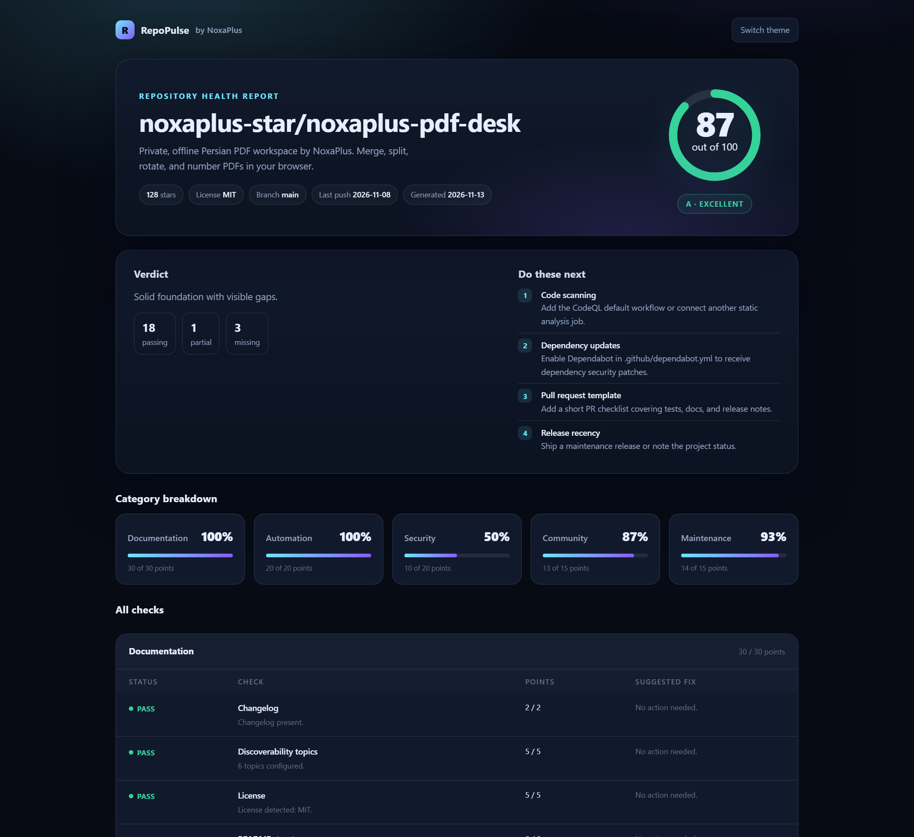

# NoxaPlus RepoPulse

**Know whether your repository is actually ready to be found, trusted, and maintained — in one command.**

RepoPulse reads a public GitHub repository through the API, scores 22 concrete signals on a 0–100 scale, and hands you a single HTML report that says what to fix first. It never writes to the repository, never asks for write access, and never sends your data anywhere except `api.github.com`.

[](https://github.com/noxaplus-star/noxaplus-repopulse/actions/workflows/ci.yml)
[](LICENSE)
[](https://nodejs.org/)


[Sample report](https://noxaplus-star.github.io/noxaplus-repopulse/) · [GitHub repository](https://github.com/noxaplus-star/noxaplus-repopulse) · [NoxaPlus](https://www.noxaplus.ir)



## Why this exists

A repository can have great code and still fail the five-second test: no description, no license, a README that never explains how to run the project, tests nobody can reproduce, or a last commit two years ago. RepoPulse turns those impressions into a repeatable check with evidence and a fix list. It is deliberately boring about it: every point comes from an observable file, workflow, release, or date. Popularity is displayed, but stars do not earn points.

Typical uses:

- **Before publishing:** catch the obvious gaps while they are still cheap to fix.
- **In CI:** fail a documentation or release-readiness pull request with `--fail-under`.
- **While reviewing dependencies:** audit a library you are about to adopt, based on maintenance signals rather than vibes.
- **In a README:** share a live score badge that links back to the full report.

## Quick start

Requires Node.js 22 or newer.

```bash
# From this repository
npm ci
npm run build
node dist/cli.js audit noxaplus-star/noxaplus-pdf-desk
```

Or install the release package globally:

```bash
npm install -g https://github.com/noxaplus-star/noxaplus-repopulse/releases/download/v1.0.0/noxaplus-repopulse-1.0.0.tgz
repopulse audit noxaplus-star/noxaplus-pdf-desk
```

No network, no token? Generate the bundled sample report:

```bash
repopulse audit --demo
```

The command writes `repopulse-<owner>-<repo>.html` and prints the score, category totals, and the highest-impact fixes. Open the file in any browser; it is fully self-contained and works offline.

### Examples

```bash
# Full GitHub URL, Markdown report, score badge
repopulse audit https://github.com/facebook/react --format markdown --out react.md --badge react.svg

# Machine-readable output for a dashboard
repopulse audit owner/repo --format json --out audit.json

# Raise the API limit and gate a release pipeline
GITHUB_TOKEN=ghp_... repopulse audit owner/repo --fail-under 80
```

## What it measures

| Category | Points | Signals |
| --- | ---: | --- |
| Documentation | 30 | Description, topics, README length, README structure, license, changelog |
| Automation | 20 | CI workflow, automated tests, one-command build, published releases |
| Security | 20 | Security policy, Dependabot or Renovate, code scanning, dependency lockfile |
| Community | 15 | Contribution guide, code of conduct, issue templates, pull request template |
| Maintenance | 15 | Recent pushes, default-branch commits, archived status, release recency |

Each check is worth full points when it passes, half when it is partial (for example, a README that exists but is too thin), and zero when it is missing. The overall score is the sum of category points, rounded to an integer.

| Score | Grade | Reading |
| ---: | :---: | --- |
| 95–100 | A+ | Release-ready with no visible gaps |
| 85–94 | A | Strong project, small gaps |
| 75–84 | B | Solid foundation, visible gaps |
| 65–74 | C | Functional, maintenance signals need work |
| 50–64 | D | Several essentials are missing |
| 0–49 | F | High risk: core community and maintenance signals are absent |

The report also lists the six fixes with the most lost points first. That ordering is the point of the tool: it answers "what should I do next?" rather than dumping a checklist.

## Output formats

### HTML (default)

A single file with no external requests. It includes:

- the 0–100 score, grade, and verdict;
- a category breakdown;
- every check with status, points, evidence, and a concrete fix;
- light and dark themes, a print stylesheet, and responsive layout;
- repository metadata such as stars, license, default branch, and last push date.

### Markdown

Useful in a release checklist or a pull request comment:

```bash
repopulse audit owner/repo --format markdown --out health.md
```

### JSON

The complete audit object, stable enough to store over time:

```bash
repopulse audit owner/repo --format json --out health.json
```

### Badge

```bash
repopulse audit owner/repo --badge health.svg
```

The SVG is standalone and uses the score color. Add it to a README with the report as the link target:

```markdown
[](repopulse-owner-repo.html)
```

## CLI reference

```text
repopulse audit <owner/repo> [options]
repopulse <owner/repo> [options]
repopulse --demo [options]
```

| Option | Description |
| --- | --- |
| `--format html\|markdown\|json` | Report format. Default: `html`. |
| `--out <path>` | Output path. Use `-` for stdout. Default: `repopulse-<owner>-<repo>.<ext>`. |
| `--badge <path>` | Also write an SVG score badge. |
| `--fail-under <score>` | Exit with code 1 when the score is below the threshold. |
| `--token <token>` | GitHub token. Default: `GITHUB_TOKEN` or `GH_TOKEN`. |
| `--demo` | Audit bundled sample data without network access. |
| `--quiet` | Suppress the terminal summary. |
| `-h, --help` | Show help. |
| `-v, --version` | Show the version. |

Exit codes: `0` audit completed, `1` score below `--fail-under`, `2` invalid usage or failed audit.

### Tokens and rate limits

Unauthenticated GitHub API requests are limited to 60 per hour, which is enough for a couple of audits. Set `GITHUB_TOKEN` (a classic token with no scopes is sufficient for public repositories) or `GH_TOKEN` to raise the limit to 5,000 per hour. The token is sent only to `api.github.com`, is never written to the report, and is never logged. For private repositories the token needs read access to the repository.

## What it does not claim

- **Signals are evidence, not proof.** A CI file can be broken and a test suite can be meaningless. RepoPulse checks whether the practice is visible, not whether it works.
- **It does not scan code for vulnerabilities.** The security category checks for a policy, dependency updates, code scanning, and a lockfile; it does not replace a security review.
- **Only the default branch is inspected.** Stale or development branches are not counted.
- **Huge trees can be truncated.** When GitHub truncates the recursive tree, file-based checks use the entries that were returned.
- **Scores are only comparable within the same tool version.** Weights may change between major versions; the version is recorded in the CHANGELOG.
- **Stars are displayed, not scored.** Popularity is not maintenance.

## Privacy

RepoPulse is a local CLI. It sends read-only requests directly from your machine to the GitHub API and writes files locally. There is no analytics, no telemetry, and no NoxaPlus server. Reports contain public repository metadata that you chose to audit; review a report before sharing it if the repository or its description is private.

## Development

```bash
npm ci          # installs dependencies and builds dist/
npm test        # 20+ unit tests for scoring, reports, API mapping, and CLI behavior
npm run typecheck
npm run build   # dist/ plus the static sample report in site/
npm run site    # regenerate site/index.html and site/badge.svg
```

The code is organized around four small modules:

- `src/github.ts` collects facts from the GitHub REST API;
- `src/checks.ts` maps facts to weighted checks and an audit result;
- `src/report.ts` renders HTML, Markdown, and the SVG badge;
- `src/cli.ts` handles arguments, output files, and exit codes.

To add a check, add a definition with a category, weight, and an `evaluate` function, then update the category weight table in `src/types.ts` so the total stays at 100. Tests use fixture facts, so no network access is required.

## Release notes

See [CHANGELOG.md](CHANGELOG.md). Security reports are handled according to [SECURITY.md](SECURITY.md).

## License

MIT © 2026 NoxaPlus. See [LICENSE](LICENSE).
